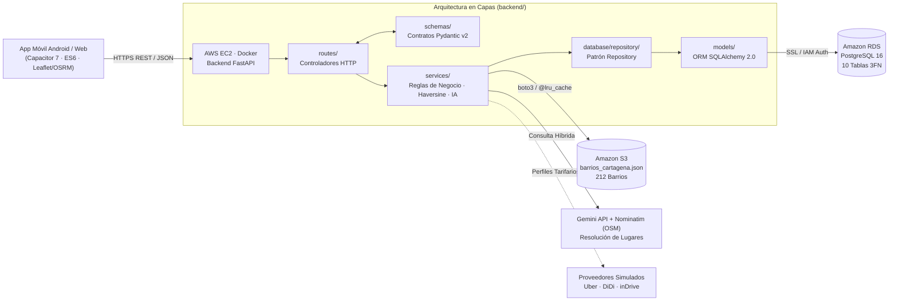

# UniX Driver — Documentación Técnica y Funcional (`ISI-2026-2-G09`)

Documentación oficial del proyecto **UniX Driver**, plataforma de búsqueda unificada y comparación de ofertas de movilidad urbana para **Cartagena de Indias, Colombia**.

---

## 1. Resumen Ejecutivo

**UniX Driver** centraliza en una única aplicación la consulta de trayectos, la comparación multicriterio de ofertas y la gestión operativa de viajes urbanos en Cartagena de Indias sobre tres plataformas de referencia (**Uber**, **DiDi** e **inDrive**), operadas mediante **proveedores simulados** con perfiles tarifarios diferenciados.

El sistema cubre dos perspectivas principales:
- **Pasajero:** Registro e inicio de sesión, gestión de perfil, selección georreferenciada de origen y destino sobre los **212 barrios oficiales de Cartagena** y lugares de interés (con geocodificación híbrida automática), trazado de ruta vial en mapa interactivo, comparación de ofertas ordenadas por recomendación, solicitud/seguimiento de viaje, cancelación con motivo y consulta de historial aislado por usuario.
- **Administrador:** Enrutamiento exclusivo por rol, monitoreo en tiempo real de indicadores operativos (KPIs), gestión de cuentas con enmascaramiento de datos de contacto (*Data Masking* — Ley 1581 de 2012), configuración y activación rápida de tasas de comisión, reportes por plataforma simulada y destinos más solicitados, y consulta de marco legal.

---

## 2. Stack Tecnológico Final

| Capa | Tecnologías y Servicios Implementados |
| :--- | :--- |
| **Base de Datos Relacional** | **PostgreSQL 16** en **Amazon RDS** (esquema de **10 tablas** en Tercera Forma Normal — 3FN, restricciones `CHECK`, relaciones `1:1` controladas, soporte SSL y autenticación por contraseña o token **AWS IAM**). |
| **Backend API REST** | **Python 3.11**, **FastAPI**, **SQLAlchemy 2.0** (ORM declarativo + patrón *Repository*), **Pydantic v2** (`@computed_field`) y **Uvicorn**, contenerizado con **Docker** sobre **Amazon EC2**. |
| **Almacenamiento Cloud y Búsqueda de Lugares** | **Amazon S3** (`boto3`) para el catálogo oficial de **212 barrios de Cartagena** (caché en RAM con `@lru_cache` y fallback local JSON) + resolución inteligente de sitios turísticos y direcciones mediante **Gemini API** (`gemini-2.5-flash`) + **Nominatim (OpenStreetMap)** + **S3**. |
| **Aplicación Móvil y Web** | **Capacitor 7** (Android APK), **HTML5 / CSS3** (*layout* adaptativo `100dvh` y pantallas 20:9), **JavaScript ES6** modular, **Leaflet** + **OSRM** para mapas y rutas viales reales. |
| **Calidad y Pruebas** | **pytest** (`TestClient` e integración con AWS S3 / RDS) en backend y **JSDOM / Node.js** (`test-v71.mjs` y `test-boton.mjs`) en la aplicación móvil. |

---

## 3. Arquitectura General del Sistema

---

## 4. Índice de Entregables por Iteración

| Documento | Descripción y Alcance Principal | Enlace |
| :--- | :--- | :--- |
| **Iteración 01** | Análisis funcional, actores, casos de uso (`DSS01P`–`DSS06P`, `DSS01A`–`DSS04A`), modelo de dominio, diagrama de clases, modelo E-R y diagramas de secuencia de diseño en PlantUML. | [iteracion-01/README.md](iteracion-01/README.md) |
| **Iteración 02** | Diseño e implementación de la base de datos relacional en PostgreSQL (`10` tablas en 3FN), evolución del prototipo móvil con el catálogo de 212 barrios de Cartagena y despliegue estático inicial. | [iteracion-02/README.md](iteracion-02/README.md) |
| **Iteración 03** | Implementación del Backend API REST en capas con FastAPI/SQLAlchemy, algoritmos geodésicos y multicriterio, despliegue en AWS (EC2, RDS, S3, Docker) y pruebas `pytest`. | [iteracion-03/README.md](iteracion-03/README.md) |
| **Iteración Final** | Integración completa Móvil–AWS, rediseño UI/UX, Panel de Administrador (Habeas Data), buscador híbrido (Gemini + Nominatim + S3) y compilación del APK. | [iteracion-final/README.md](iteracion-final/README.md) |
| **Manual de Usuario** | Guía operativa paso a paso para los roles **Pasajero** y **Administrador**, requisitos, instalación del APK y solución de problemas frecuentes. | [iteracion-final/MANUAL_USUARIO.md](iteracion-final/MANUAL_USUARIO.md) |

### Documentación Técnica Complementaria
- **Esquema y scripts SQL de base de datos:** [database/README.md](../database/README.md)
- **Guía de despliegue y ejecución del servidor API:** [backend/README.md](../backend/README.md)

---

## 5. Integrantes del Equipo

- **Ivan Andres Sierra Arrieta**
- **Sebastian de Jesus Morales Marimon**
