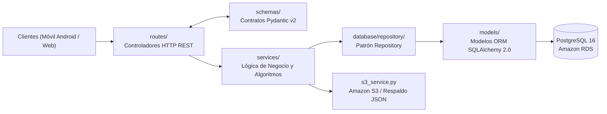

# Iteración 03 — Backend API REST y Despliegue Cloud en AWS

Esta carpeta documenta la arquitectura del servidor, los algoritmos de dominio, los endpoints REST y el despliegue de la infraestructura en **Amazon Web Services (AWS)** desarrollados durante la tercera iteración de **UniX Driver**.

---

## Objetivo

Construir una API REST robusta y desacoplada en **FastAPI**, **SQLAlchemy 2.0** y **Pydantic v2** siguiendo una arquitectura en capas estricta, implementar los algoritmos geodésicos y de negocio de la plataforma y desplegar la solución en la nube (**Amazon S3**, **Amazon RDS PostgreSQL** y contenedor **Docker** en **Amazon EC2**).

---

## 1. Arquitectura en Capas del Backend (`backend/`)

| Capa | Directorio | Responsabilidad |
| :--- | :--- | :--- |
| **Presentación (HTTP)** | `backend/routes/` | Definición de rutas REST, códigos de estado, validaciones query/path e inyección de sesión `Depends(get_db)`. |
| **Contratos (DTOs)** | `backend/schemas/` | Validación estricta de entrada y serialización de salida con **Pydantic v2** (`ConfigDict(from_attributes=True)`). |
| **Lógica de Dominio** | `backend/services/` | Búsqueda binaria de barrios, distancia de Haversine, cotización simulada, ranking multicriterio, máquina de estados del viaje y liquidación de comisiones. |
| **Persistencia (Repository)** | `backend/database/repository/` | Consultas transaccionales con SQLAlchemy 2.0 (`select`, `joinedload`, `flush`, `commit`), desacoplando el acceso SQL de los servicios. |
| **Modelos ORM** | `backend/models/` | Mapeo objeto-relacional de las 10 entidades del esquema PostgreSQL (`usuario`, `rol`, `plataforma`, `conductor`, `vehiculo`, `busqueda`, `oferta`, `viaje`, `configuracion_comision`, `comision`). |
| **Infraestructura de Datos** | `backend/database/` | Pool de conexiones SQLAlchemy (`pool_pre_ping`), soporte dual para conexión estándar o **AWS RDS IAM Authentication** con SSL. |

---

## 2. Algoritmos y Lógica de Dominio

### 2.1. Catálogo de 212 Barrios en RAM y Búsqueda Binaria $O(\log n)$
- El módulo `backend/services/s3_service.py` descarga `barrios_cartagena.json` desde **Amazon S3** al iniciar las consultas y utiliza `backend/data/barrios_cartagena.json` como respaldo automático ante falta de conectividad o credenciales.
- `cargar_barrios_cartagena()` almacena el catálogo normalizado en memoria mediante `@lru_cache(maxsize=1)`, convirtiendo cada nombre a mayúsculas sin tildes y ordenándolo alfabéticamente.
- `buscar_barrio_binaria()` resuelve cualquier barrio oficial en complejidad temporal **$O(\log n)$** mediante búsqueda binaria clásica, incorporando coincidencia parcial de respaldo cuando el usuario incluye puntos de referencia adicionales.

### 2.2. Cálculo Geodésico de Haversine con Factor Vial Urbano
- `calcular_distancia_haversine_km()` calcula la distancia ortodrómica entre las coordenadas $(X = \text{lon}, Y = \text{lat})$ de origen y destino sobre el radio terrestre ($R = 6371.0\text{ km}$).
- Aplica el **factor de corrección vial urbano `1.30x`** ajustado a la topografía de Cartagena de Indias (cuerpos de agua, puentes y desvíos viales), garantizando un mínimo operativo de `1.5 km`.

### 2.3. Cotización Simulada y Ranking Multicriterio (`Uber`, `DiDi`, `inDrive`)
- `ejecutar_busqueda_unificada()` genera cotizaciones comparativas sobre las tres plataformas activas (**Uber**, **DiDi** e **inDrive**), operando como **proveedores simulados** mediante perfiles tarifarios diferenciados (tarifa base, valor por kilómetro y variación de tiempo estimado).
- `_calcular_puntaje_recomendacion()` ordena automáticamente las ofertas de mejor a peor opción ponderando:
  - **Precio estimado (`50%`)**
  - **Tiempo estimado de llegada/recorrido (`30%`)**
  - **Calificación del conductor (`20%`)**

### 2.4. Máquina de Estados del Viaje y Liquidación Automática de Comisiones
- **Solicitud (`POST /viajes/solicitar`):** Valida disponibilidad de la oferta, registra el viaje en estado `SOLICITADO` y marca la oferta como `SELECCIONADA`.
- **Transiciones controladas (`PATCH /viajes/{id_viaje}/estado`):** Aplica el flujo `SOLICITADO → ACEPTADO → EN_CURSO → COMPLETADO` (con transición permitida hacia el estado terminal `CANCELADO`). Cualquier intento de revertir un estado terminal (`COMPLETADO` o `CANCELADO`) retorna `409 Conflict`.
- **Liquidación automática y cálculo dinámico (`@computed_field`):** Cuando un viaje pasa a `COMPLETADO`, se crea de forma idempotente su registro en `comision` vinculado a la regla `ACTIVA` de `configuracion_comision`. En cumplimiento de la 3FN, `ComisionRespuesta` expone el monto monetario dinámicamente mediante el campo calculado `@computed_field` (`monto_calculado`) sin duplicar valores en base de datos.

---

## 3. Resumen de Endpoints de la API REST

| Módulo | Método | Ruta | Caso de Uso / Descripción |
| :--- | :---: | :--- | :--- |
| **Sistema** | `GET` | `/` | Metadatos de la API y enlace a `/docs`. |
| **Sistema** | `GET` | `/health` | Verificación de disponibilidad del servicio. |
| **Usuarios** | `GET` | `/usuarios/` | **DSS02A** — Listar usuarios con filtro opcional por `id_rol` o `estado`. |
| **Usuarios** | `POST` | `/usuarios/registro` | **DSS01P** — Registrar nuevo usuario con validación de correo único. |
| **Usuarios** | `POST` | `/usuarios/login` | **DSS02P / DSS01A** — Autenticar usuario y devolver perfil con rol y estado. |
| **Usuarios** | `GET` | `/usuarios/{id_usuario}` | **DSS03P** — Consultar perfil de usuario. |
| **Usuarios** | `PUT` | `/usuarios/{id_usuario}` | **DSS03P** — Actualizar nombre, teléfono y fecha de nacimiento. |
| **Usuarios** | `PATCH` | `/usuarios/{id_usuario}/estado` | **DSS02A** — Cambiar estado de cuenta (`ACTIVO`, `INACTIVO`, `SUSPENDIDO`). |
| **Búsquedas** | `GET` | `/busquedas/barrios` | Listar o autocompletar (`?q=`) los 212 barrios oficiales de Cartagena. |
| **Búsquedas** | `POST` | `/busquedas/` | **DSS04P** — Ejecutar búsqueda unificada y ordenar ofertas (**Uber**, **DiDi**, **inDrive** simulados). |
| **Búsquedas** | `GET` | `/busquedas/{id_busqueda}` | Consultar una búsqueda registrada y sus ofertas asociadas. |
| **Viajes** | `GET` | `/viajes/` | **DSS04A** — Listar todos los viajes del sistema para supervisión y reportes. |
| **Viajes** | `POST` | `/viajes/solicitar` | **DSS05P** — Seleccionar oferta y registrar viaje en estado `SOLICITADO`. |
| **Viajes** | `GET` | `/viajes/usuario/{id_usuario}` | **DSS06P** — Consultar historial de viajes de un pasajero específico. |
| **Viajes** | `GET` | `/viajes/{id_viaje}` | Consultar detalle y estado actual de un viaje. |
| **Viajes** | `PATCH` | `/viajes/{id_viaje}/estado` | Actualizar estado del viaje (liquida comisión al pasar a `COMPLETADO`). |
| **Comisiones** | `GET` | `/comisiones/configuracion/activa` | Consultar la regla de comisión vigente (`ACTIVA`). |
| **Comisiones** | `GET` | `/comisiones/configuracion/historial` | Consultar el historial cronológico de configuraciones de comisión. |
| **Comisiones** | `POST` | `/comisiones/configuracion` | **DSS03A** — Crear y activar nueva tasa de comisión (desactiva la regla anterior). |
| **Comisiones** | `GET` | `/comisiones/` | **DSS04A** — Listar comisiones generadas con cálculo dinámico de `monto_calculado`. |

---

## 4. Integración, Despliegue en AWS y Pruebas Automatizadas

- **Amazon S3:** Aloja el archivo oficial `barrios_cartagena.json`, descargado mediante `boto3` utilizando credenciales configuradas por variables de entorno en `.env` (sin exponer secretos en el repositorio).
- **Amazon RDS PostgreSQL:** Instancia administrada en AWS conectada desde `backend/database/conexion.py` con soporte para conexión SSL y generación automática de tokens de autenticación **RDS IAM** (`USE_RDS_IAM=true`).
- **Contenedor Docker en Amazon EC2:** El archivo `backend/Dockerfile` construye una imagen ligera basada en `python:3.11-slim` que ejecuta el servidor ASGI `uvicorn backend.main:app` en el puerto `8000` (despliegue configurable también en local mediante `docker-compose.yml`).
- **Suite de Pruebas (`pytest`):** En `tests/test_backend_aws.py` se automatizó la verificación del catálogo de 212 barrios, la búsqueda binaria, la distancia Haversine, el cálculo dinámico de comisiones sin redundancia y las pruebas de integración reales hacia AWS S3 y AWS RDS.

---

## Integrantes

- **Ivan Andres Sierra Arrieta**
- **Sebastian de Jesus Morales Marimon**

## Estado de la Entrega

- [x] Arquitectura en capas del backend FastAPI + SQLAlchemy 2.0 + Pydantic v2.
- [x] Búsqueda binaria $O(\log n)$, cálculo Haversine (`1.30x`) y ranking multicriterio para **Uber**, **DiDi** e **inDrive** (simulados).
- [x] Máquina de estados del viaje y liquidación automática de comisiones con `@computed_field`.
- [x] Integración y despliegue en AWS (S3, RDS PostgreSQL y EC2 con Docker) y pruebas `pytest`.
