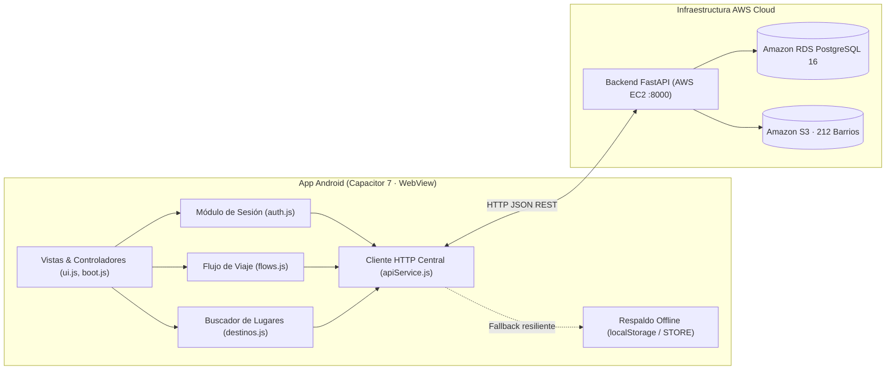

# UniX Driver · Cartagena — Aplicación Móvil Conectada a AWS REST API (v7.2)

Aplicación móvil híbrida para Android (**Capacitor 7 + HTML5/CSS3/ES6**) del proyecto **UniX Driver**, integrada con el backend **FastAPI desplegado en AWS EC2**, **Amazon RDS (PostgreSQL 16)** y **Amazon S3** para cotización unificada en tiempo real sobre **Uber**, **DiDi** e **inDrive**.

---

## 1. Arquitectura de Integración Mobile → AWS Cloud



---

## 2. Resumen de Cambios de Ingeniería Realizados

### 2.1. Cliente HTTP Centralizado e Inyección Dinámica desde `.env` (`www/js/apiService.js` y `tools/sync-env.js`)
Se refactorizó y estandarizó [`www/js/apiService.js`](file:///c:/Users/ivans/Desktop/Repositorios/ISI-2026-2-G09/mobile/unix-driver-7.2/www/js/apiService.js) bajo el patrón **IIFE / Singleton Global** (`window.apiService` y `window.UNIX_API_URL`), eliminando IPs quemadas en el código fuente versionado:
- **Inyección desde `.env` (`tools/sync-env.js`)**: El script [`tools/sync-env.js`](file:///c:/Users/ivans/Desktop/Repositorios/ISI-2026-2-G09/mobile/unix-driver-7.2/tools/sync-env.js) lee `UNIX_API_BASE_URL` desde `mobile/unix-driver-7.2/.env` (o usa `'http://localhost:8000'` si no existe `.env`) y genera automáticamente `www/config/api-env.js` (excluido en `.gitignore`).
- **Prioridad Absoluta de `window.UNIX_API_URL`**: Si `window.UNIX_API_URL` está definido, `apiService.js` lo prioriza sobre cualquier valor antiguo en `localStorage` (`unixdriver.api.url`) y sincroniza el almacenamiento local automáticamente.
- **Control de Timeouts (`AbortController`)**: Cancela peticiones colgadas tras `7000 ms` sin bloquear el hilo de interfaz.
- **Cobertura completa de casos de uso**:
  - `verificarSalud()` → `GET /health`
  - `login(correo, contrasena)` → `POST /usuarios/login` (**DSS02P**)
  - `registrar(datosUsuario)` → `POST /usuarios/registro` (**DSS01P**)
  - `obtenerPerfil(idUsuario)` / `actualizarPerfil(idUsuario, datos)` → `GET/PUT /usuarios/{id_usuario}` (**DSS03P**)
  - `obtenerBarrios(query)` → `GET /busquedas/barrios` (catálogo oficial desde **Amazon S3**)
  - `buscarOfertas(origen, destino, idUsuario)` → `POST /busquedas/` (**DSS04P** — **Uber**, **DiDi**, **inDrive**)
  - `solicitarViaje(idOferta)` → `POST /viajes/solicitar` (**DSS05P**)
  - `actualizarEstadoViaje(idViaje, estado, precioFinal)` → `PATCH /viajes/{id_viaje}/estado` (máquina de estados y liquidación automática de comisión al pasar a `COMPLETADO`)
  - `obtenerHistorialViajes(idUsuario)` → `GET /viajes/usuario/{id_usuario}` (**DSS06P**)
  - `obtenerComisionActiva()` → `GET /comisiones/configuracion/activa`

### 2.2. Autenticación Conectada a Amazon RDS (`www/js/auth.js`)
En [`www/js/auth.js`](file:///c:/Users/ivans/Desktop/Repositorios/ISI-2026-2-G09/mobile/unix-driver-7.2/www/js/auth.js):
- `AUTH.registrar` e `AUTH.ingresar` consumen `POST /usuarios/registro` y `POST /usuarios/login` a través de `apiService`.
- Se valida la estructura de respuesta de PostgreSQL (`typeof api.data.id_usuario === 'number'`) y se almacena el `id_usuario` real en la sesión activa (`unixdriver.sesion.v2`), permitiendo asociar búsquedas y viajes al pasajero autenticado en RDS.
- Mantiene respaldo criptográfico local (`SHA-256` con WebCrypto) si el dispositivo pierde conectividad móvil.

### 2.3. Sincronización del Catálogo de 212 Barrios desde Amazon S3 (`www/js/destinos.js`)
En [`www/js/destinos.js`](file:///c:/Users/ivans/Desktop/Repositorios/ISI-2026-2-G09/mobile/unix-driver-7.2/www/js/destinos.js):
- La función `cargarDestinos()` carga de inmediato la base local de sitios de interés y ejecuta en segundo plano `sincronizarBarriosDesdeAws()`, consumiendo `GET /busquedas/barrios`.
- Enriquecimiento automático de coordenadas (`coordenada_y` → `lat`, `coordenada_x` → `lon`) e incorporación de cualquier barrio oficial proveniente del bucket S3 `unixdriver-data-cartagenabarrios-2026`.

### 2.4. Flujo Completo del Viaje y Liquidación de Comisiones (`www/js/flows.js`)
En [`www/js/flows.js`](file:///c:/Users/ivans/Desktop/Repositorios/ISI-2026-2-G09/mobile/unix-driver-7.2/www/js/flows.js):
- **Cotización Unificada (`mostrarOfertas`)**: Consume `apiService.buscarOfertas(origen, destino, idUsuario)`, recibiendo las ofertas de **Uber**, **DiDi** e **inDrive** ordenadas por el algoritmo multicriterio del backend (65% precio / 35% tiempo de llegada) y aplicando el factor de motocicleta (`0.45x`) cuando corresponde.
- **Solicitud de Viaje (`seleccionarOferta`)**: Registra el viaje en RDS mediante `apiService.solicitarViaje(id_oferta)` y guarda `trip.id_viaje`.
- **Sincronización de Estados (`conductorEnCamino`, `iniciarViaje`, `finalizarViaje`, `confirmarCancelacion`)**: Envía `PATCH /viajes/{id_viaje}/estado` en cada transición (`ACEPTADO` → `EN_CURSO` → `COMPLETADO` / `CANCELADO`), disparando en RDS la generación automática de la comisión al completar el viaje.
- **Porcentaje de Comisión Dinámico (`sincronizarComisionVigente`)**: Consulta `GET /comisiones/configuracion/activa` para aplicar la tasa vigente configurada por el administrador en base de datos.

### 2.5. Historial Remoto y Estado de Cuenta (`www/js/ui.js`)
En [`www/js/ui.js`](file:///c:/Users/ivans/Desktop/Repositorios/ISI-2026-2-G09/mobile/unix-driver-7.2/www/js/ui.js):
- `renderHistorial()` ejecuta `sincronizarHistorialDesdeAws()`, consultando `GET /viajes/usuario/{id_usuario}` y fusionando los viajes registrados en PostgreSQL (`RDS-{id_viaje}`) con el historial del dispositivo.
- El panel **Mi Cuenta** informa en tiempo real el endpoint AWS activo (`#authTechNotice`).

### 2.6. Configuración de Entorno y Seguridad de Red en Android
- **Configuración Central ([`www/config/tarifas.js`](file:///c:/Users/ivans/Desktop/Repositorios/ISI-2026-2-G09/mobile/unix-driver-7.2/www/config/tarifas.js))**: Se añadió el bloque `UNIX_CONFIG.api` con `baseUrl: (typeof window !== 'undefined' && window.UNIX_API_URL) || 'http://localhost:8000'`, `fallbackUrls: []` y `timeoutMs: 8000`.
- **Variables de Entorno ([`.env`](file:///c:/Users/ivans/Desktop/Repositorios/ISI-2026-2-G09/mobile/unix-driver-7.2/.env) y [`.env.example`](file:///c:/Users/ivans/Desktop/Repositorios/ISI-2026-2-G09/mobile/unix-driver-7.2/.env.example))**: Definición de `UNIX_API_BASE_URL` en `.env` (ignorado por Git) y plantilla limpia en `.env.example`.
- **Permisos de Tráfico HTTP en Android 9–15 ([`AndroidManifest.xml`](file:///c:/Users/ivans/Desktop/Repositorios/ISI-2026-2-G09/mobile/unix-driver-7.2/android/app/src/main/AndroidManifest.xml) y [`network_security_config.xml`](file:///c:/Users/ivans/Desktop/Repositorios/ISI-2026-2-G09/mobile/unix-driver-7.2/android/app/src/main/res/xml/network_security_config.xml))**:
  - Se cambió `android:usesCleartextTraffic="false"` a `android:usesCleartextTraffic="true"` en `AndroidManifest.xml`.
  - Se creó `android/app/src/main/res/xml/network_security_config.xml` con `cleartextTrafficPermitted="true"`, evitando que el WebView de Android bloquee las peticiones `http://` hacia el puerto `8000` de AWS EC2 (`ERR_CLEARTEXT_NOT_PERMITTED`).

---

## 3. Mapeo de Endpoints Consumidos por la Vista Mobile

| Caso de Uso | Método y Ruta en AWS | Método en `apiService` | Módulo Consumidor |
| :--- | :--- | :--- | :--- |
| **Healthcheck** | `GET /health` | `verificarSalud()` | `apiService.js` |
| **DSS01P — Registro** | `POST /usuarios/registro` | `registrar(datos)` | `auth.js` (`AUTH.registrar`) |
| **DSS02P — Login** | `POST /usuarios/login` | `login(correo, contrasena)` | `auth.js` (`AUTH.ingresar`) |
| **DSS03P — Perfil** | `GET / PUT /usuarios/{id}` | `obtenerPerfil()` / `actualizarPerfil()` | `apiService.js` |
| **Catálogo S3 (212 Barrios)** | `GET /busquedas/barrios` | `obtenerBarrios(q)` | `destinos.js` (`sincronizarBarriosDesdeAws`) |
| **DSS04P — Búsqueda Unificada** | `POST /busquedas/` | `buscarOfertas(origen, destino, idUsuario)` | `flows.js` (`FLOW.mostrarOfertas`) |
| **DSS05P — Solicitar Viaje** | `POST /viajes/solicitar` | `solicitarViaje(idOferta)` | `flows.js` (`FLOW.seleccionarOferta`) |
| **Ciclo de Vida y Comisión** | `PATCH /viajes/{id}/estado` | `actualizarEstadoViaje(id, estado, precio)` | `flows.js` (`conductorEnCamino`, `iniciarViaje`, `finalizarViaje`, `confirmarCancelacion`) |
| **DSS06P — Historial** | `GET /viajes/usuario/{id}` | `obtenerHistorialViajes(idUsuario)` | `ui.js` (`sincronizarHistorialDesdeAws`) |
| **DSS01A — Comisión Activa** | `GET /comisiones/configuracion/activa` | `obtenerComisionActiva()` | `flows.js` (`sincronizarComisionVigente`) |

---

## 4. Cómo Cambiar la IP o Dominio del Backend en AWS

Si la dirección IP pública de la instancia EC2 cambia al reiniciarla en AWS:

1. **En el archivo `.env` (Recomendado)**:
   Edita [`mobile/unix-driver-7.2/.env`](file:///c:/Users/ivans/Desktop/Repositorios/ISI-2026-2-G09/mobile/unix-driver-7.2/.env):
   ```ini
   UNIX_API_BASE_URL=http://TU_NUEVA_IP_EC2:8000
   ```
   Luego ejecuta `npm run env:sync` (o `npm run build:web` / `npm run sync`), lo que actualizará `www/config/api-env.js` automáticamente.
2. **En caliente desde la consola de inspección (`chrome://inspect`)**:
   ```javascript
   apiService.setBaseUrl('http://TU_NUEVA_IP_EC2:8000');
   ```

---

## 5. Compilación y Empaquetado del APK

### Requisitos del Sistema
- **Node.js** 20 LTS o superior
- **JDK 21** (requerido por Gradle 8.11.1)
- **Android SDK** (`platforms;android-35` y `build-tools;35.0.0`)

### Comandos de Construcción

Desde la carpeta `mobile/unix-driver-7.2`:

```powershell
# 1. Instalar dependencias de Node y Capacitor
npm install

# 2. Regenerar el bundle web autocontenido (UniX-Driver.html)
npm run build:web

# 3. Sincronizar activos web y configuración con el proyecto nativo Android
npm run sync

# 4. Compilar APK de depuración (listo para instalar en dispositivo o emulador)
cd android
.\gradlew.bat assembleDebug
```

El APK compilado se genera en:
`mobile/unix-driver-7.2/android/app/build/outputs/apk/debug/app-debug.apk`

---

## 6. Estructura del Proyecto Mobile

```text
mobile/unix-driver-7.2/
├── www/                             # Aplicación Web empaquetada por Capacitor
│   ├── index.html                   # Vistas SPA (Autenticación, Mapa, Ofertas, Viaje, Pago, Historial)
│   ├── styles*.css                  # Hojas de estilo modulares
│   ├── config/
│   │   ├── api-env.js               # Autogenerado desde .env por tools/sync-env.js (ignorado en Git)
│   │   ├── tarifas.js               # Configuración central (Tarifas, Mapas y Endpoints API)
│   │   └── firebase-config.js       # Configuración opcional de Firebase
│   ├── data/
│   │   └── destinos.json            # Catálogo local base enriquecido en vivo desde AWS S3
│   ├── js/
│   │   ├── apiService.js            # Cliente HTTP centralizado hacia el Backend FastAPI
│   │   ├── auth.js                  # Registro y login contra AWS RDS + respaldo SHA-256 local
│   │   ├── destinos.js              # Buscador y sincronización de los 212 barrios con AWS S3
│   │   ├── flows.js                 # Cotización (Uber/DiDi/inDrive), solicitud y estados del viaje
│   │   ├── ui.js                    # Navegación, cuenta e historial sincronizado con RDS
│   │   ├── state.js                 # Estado reactivo central y cálculo de tarifas por km
│   │   ├── mapa.js                  # Integración Leaflet + rutas OSRM
│   │   ├── origen.js                # Selector de origen y GPS
│   │   ├── viaje.js                 # Vista de seguimiento en tiempo real
│   │   └── boot.js                  # Inicialización de eventos y botón Atrás nativo
│   └── img/                         # Logos oficiales de Uber, DiDi e inDrive
├── android/                         # Proyecto nativo Android (Capacitor 7 + Gradle 8.11)
│   └── app/src/main/
│       ├── AndroidManifest.xml      # Permisos de Internet, GPS y usesCleartextTraffic="true"
│       └── res/xml/
│           └── network_security_config.xml # Política de seguridad de red para HTTP hacia AWS EC2
├── tools/                           # Scripts de empaquetado web (build-html.js, build-destinos.js)
├── tests/                           # Suite de pruebas automatizadas (JSDOM)
├── capacitor.config.json            # Configuración de Capacitor (cleartext + mixed content habilitados)
├── .env / .env.example              # Variables de entorno para conexión AWS
└── package.json                     # Scripts de construcción y dependencias
```
